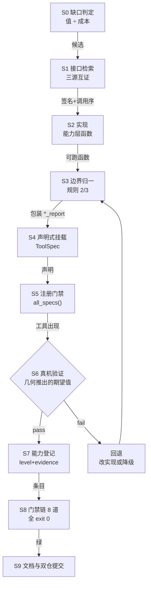

# 从「一个官方接口」到「一个 MCP 工具」：完整流水线

> 本文用**一条真实流水线**说明每个环节的**原料 / 工作内容 / 产物**。
> 例：`solidworks_measure_selection`（2026-10-01 · 轮 311）—— 从"四家有我们没有"的判定到两仓提交，全程可复算。
> 术语：[能力层] = `scripts/*.py`（纯 Python，可直接跑）· [工具层] = `mcp-server/`（声明式，不写实现）·
> [门禁] = `scripts/check_*.py`（可执行的不变量）。

---

## 一、总图



**ASCII 版**（★ 便于终端阅读）：

```
 S0 缺口判定 ──▶ S1 接口检索 ──▶ S2 实现 ──▶ S3 边界归一 ──▶ S4 声明式挂载
                                                                     │
                                                                     ▼
   S9 文档+提交 ◀── S8 门禁链8道 ◀── S7 能力登记 ◀──[pass]◀── S6 真机验证
                                                          │
                                                     [fail]└──▶ 回退（改 S2/S3，或降级为 stitched）
```

**唯一的硬闸门是 S6**：★ 验不过 ⇒ **回退**，不许留在柜台上（本仓库的核心判据：A 挂工具 与 B 真机证据**必须配对**）。

---

## 二、逐环节：原料 / 工作内容 / 产物

### S0 · 缺口判定（值 ÷ 成本）
| | |
|---|---|
| **原料** | `tools/union-sources.json`（四家并集 **349** 个操作）· `capabilities.yaml`（我们 **77** 条能力）· `register_capabilities.all_specs()`（我们 **183** 个工具）· `docs/union-coverage-matrix.md` §五（逐域缺口） |
| **工作内容** | ① 算**功能级**差集（不是名字级 —— 硬约束④「核功能不核名字」）；② 逐条人工核假缺口；③ 排"值 ÷ 成本" |
| **产物** | `output/union-gap.json`（349 → 交叠度 0 的**强候选 69** 个）+ **一份人工核过的小表** |
| **本例** | 核 6 条 → **5 条是假缺口**（`bbox`/`shell`/`export_to_step`/`pack_and_go`/`run_review` 都已有同功能工具）⇒ 真缺是 `measure` + `measure_distance` |
| **可跑命令** | `python D:\AI\SW\compute_union_gap.py` |

### S1 · 接口检索（三源互证）
| | |
|---|---|
| **原料** | ① `C:\swapi\types\`（结构化 md，查**精确签名**与枚举值）② `D:\AI\SW\AI Solidworks\官方文档\SWhelp\`（CHM 解包，查**语义与用法**）③ **出厂类型库反射**（`scripts/sw_api_sldworks.py` 的 arity 表 —— **冲突时以它为准**，铁律 4）④ `C:\swapi\examples\`（**官方示例**，给**调用序**） |
| **工作内容** | ① 查**入口成员**；② **按字符读全签名行**（★ 被打印宽度截断会误判，见"坑 1"）；③ 对 arity；④ **找官方示例**（§5.0：判据先找后搓） |
| **产物** | **签名 + arity + 调用序 + 枚举取值**（写在能力层函数的来源块注释里，可追溯） |
| **本例** | `IModelDocExtension.CreateMeasure()` → `IMeasure`（33 成员）· 官方示例 `Measure_Selected_Entities_Example_VB.md` 给出 6 步调用序 · 反射 arity 表交叉验证 |

### S2 · 实现（能力层函数）
| | |
|---|---|
| **原料** | S1 的签名与调用序 · **四家实现（只读对照，抄判据不抄实现）** · 本仓库既有模式（`sw_connect.get_com_member` / `_select_com_object`） |
| **工作内容** | ① 写纯 Python 函数（**不碰 MCP**）；② 每个 COM 调用**参数顺序与类型对齐官方签名**；③ 每次读 COM 成员都走 helper（**因为 helper 的语义有坑**，见"坑 2"） |
| **产物** | `scripts/sw_measure.py`（能力层新模块）· 带**来源块注释**（仓库/文件/定位/官方签名依据/许可/覆盖） |
| **本例** | `measure_selection_report(model, arc_option)` · `MEASURE_FIELDS` / `MEASURE_FLAGS` 两张表（16 个量 + 3 个布尔判定） |

### S3 · 边界归一（规则 2 / 3）
| | |
|---|---|
| **原料** | S2 的函数 · `sw_connect.mm()`（毫米→米）· `sw_selection_spec`（声明式选择） |
| **工作内容** | ① **换算只在边界做一次**（参数名 `_mm` / `_deg` 收毫米/度，函数内部用米/弧度）；② **不暴露裸坐标** `x`/`y`/`z`（用 `selection` 参数）；③ **建/改之后回读**（规则 6：不静默成功） |
| **产物** | `*_report(...)` 形式的**包装**（回 `dict`，含 `ok` 与判据字段） |
| **本例** | `arc_option` 校验（只收 0/1/2）· **回读 `GetSelectedObjectCount2(-1)`** 确认"真的选中了"· `-1` **如实保留**（官方约定"不适用"）并另给 `applicable` |

### S4 · 声明式挂载（ToolSpec）
| | |
|---|---|
| **原料** | S3 的包装 · `mcp-server/tool_registry.py` 的 `ToolSpec` / `Param` · `RESOLVERS`（`model`/`sw_app`/`study`/`asm_model`/`manager`） |
| **工作内容** | ① 写 `ToolSpec(name, module, function, inject, params, doc)`；② **`inject` 用字符串**（不是元组）；③ **`Param.kind` 传类型对象**（`str`/`int`/`float`/`bool`，**不是** `"string"`）；④ 参数名写 `_mm`/`_deg` |
| **产物** | `mcp-server/tool_specs_batch46.py`（一批一个文件） |
| **本例** | `name="solidworks_measure_selection"` · `inject="model"` · 一个 `Param("arc_option", int, default=1, …)` |

### S5 · 注册门禁（all_specs()）
| | |
|---|---|
| **原料** | S4 的声明 · `register_capabilities.BATCH_MODULES`（模块名清单） |
| **工作内容** | ① 把批次模块名加进 `BATCH_MODULES`；② 注册时会跑**三条机器判定**（命名正则 / 缺 title / `pre_call` 与 `extra_op` 冲突），违者抛 `GateError` |
| **产物** | **`all_specs()` 里多一行**（本例 182 → **183**） |
| **判据** | `python -c "…; print(len(rc.all_specs()))"` |

### S6 · 真机验证 ★ **唯一的硬闸门**
| | |
|---|---|
| **原料** | S3 的包装 · **一组"期望值"** —— 优先用**几何推出的公式**（§5.0），不用"看着像对" · 一个探针脚本 |
| **工作内容** | ① `CommandInProgress=True` 抑制模态框；② 建几何 → 调用 → **回读**；③ 比对期望；④ **正例 + 负例都要**；⑤ `finally` 收尾（关自己开的文档） |
| **产物** | `output/measure-evidence.json`（带 `verdict: pass|partial|fail`） |
| **本例** | 期望**全部由几何推出**：板厚 10 ⇒ `distance=10.0` ✓ · 20×20 ⇒ `area=400.0` ✓ · 4×20 ⇒ `perimeter=80.0` ✓ · 未选中 ⇒ 显式拒绝 ✓ ⇒ **3/3 PASS** |
| **失败时** | **回退**：改 S2/S3 重验；若查明是**环境/后端受限**（如加载项缺、pywin32 指针接口），则**降级为 `stitched`** 并写明理由 |

### S7 · 能力登记（capabilities.yaml）
| | |
|---|---|
| **原料** | S6 的证据 json · 该能力的**授权面**（`allowed_modes`） |
| **工作内容** | ① 建/改条目：`level`（五级枚举）· `evidence`（**指向证据文件**）· `limitations`（**未验的也要写**）· `mcp_tools`（**每个工具都要有人认领**）· `verified_versions` |
| **产物** | `capabilities.yaml` 条目（本例新增 `geometry_measurement`，能力 76 → **77**，verified 54 → **55**） |
| **判据** | `python tools/check_tool_capability_coverage.py`（188/188 全认领） |

### S8 · 门禁链（8 道，全 exit 0）
| 门禁 | 它管什么 |
|---|---|
| `sync_bundled_skill.py` | 桌面内嵌 Skill 快照与根 Skill 一致（**改了运行时文件必须跑**） |
| `check_union_conventions.py` | 五统一：命名 / 单位 / 选择 / 验证等级 / 出处 |
| `gen_metrics.py` | 33 项指标（**数字只从生成物来**） |
| `gen_harvest_digest.py` | 提交摘要 |
| `check_digest_freshness.py` | 摘要新鲜度 |
| `check_report_freshness.py` | `harvest-report` 的偏离数字与 git 相符 |
| `release_check.py` | 发布前总闸（含出处/来源块行覆盖） |
| `check_spec_acceptance_paths.py` | 每批的"验收命令"真的存在 |
| **外加** | `check_param_binding.py`（参数绑定 + **形态**）· 全量 `pytest`（**1284 passed / 0 failed**） |

### S9 · 文档与双仓提交
| | |
|---|---|
| **原料** | 全流程产物 |
| **工作内容** | ① `docs/known-facts.md` 追一条**事实**（可复用的教训）；② `docs/ROADMAP.md` §一 推游标；③ `specs/<NNN>-<slug>/` 走 Spec Kit 五件套（specify→clarify→plan→checklist→tasks）；④ **两仓各自 commit**（code 副本 + 工作区），**不 push** |
| **产物** | 本例：code `d801a97` · work `1e5c0b2` |

---

## 三、两个真实踩过的坑（说明为什么每步都要"回读/对源"）

### 坑 1 · 签名被打印宽度截断 ⇒ 误判"API 不可用"
`FeatureExtruRefSurface3` 官方签名有 **22 个参数**，而我只看到前 8 个（终端截断）⇒ 报 `DISP_E_BADPARAMCOUNT` ⇒ **看起来像"这个 API 不行"**。用反射 arity 表（`sw_api_sldworks.py` 写 `22`）一对 ⇒ 补全 22 个参数 ⇒ **立刻通过**。**⇒ 定则：签名要按字符读全；arity 一律以反射表为准。**

### 坑 2 · helper 的语义不是"取值"
`IMeasure.Calculate` 的官方示例写 `Calculate(Nothing)`。照抄成 `get_com_member(m, "Calculate", None)` ⇒ `TypeError: 'bool' object is not callable`。因为本仓库 `get_com_member` 的语义是**「取或调」** —— 传了实参就**先无参调一次**（回 `True`），**再拿那个 `True` 去"调用"**。**⇒ 定则：移植官方示例时，每个 `obj.Member(args)` 都要按本仓库 helper 的语义改写。**

---

## 四、读这张图最该记住的三件事

1. **S1 与 S6 是"贵"的两步** —— 检索要对**三源**（文档 / CHM / 反射），验证要**真机 + 几何推出的期望值**。中间几步（S2–S5）是机械劳动。
2. **S6 失败要回退，不是"改判据"** —— 这是本仓库唯一不许绕的闸门；环境受限的才允许降级为 `stitched`，且**必须写明理由**。
3. **一个工具 = 一行 `all_specs()` + 一条 `capabilities.yaml` 条目 + 一份 `output/*-evidence.json`** —— 三者缺一，这条就没做完。
