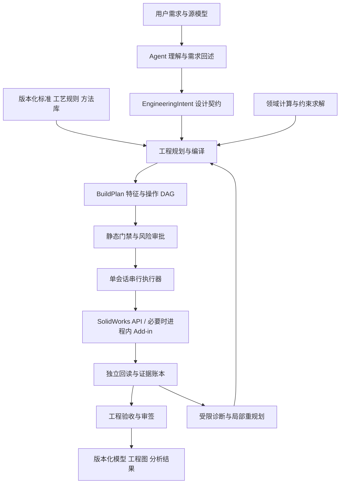

# 从“工具覆盖”到“工程建模能力”：SolidWorks Agent 生产级架构与实施路线

- 日期：2026-10-08
- 适用项目：`D:/AI/SW`；面向 DSH、WorkBuddy 及其他 Agent 宿主
- 文档性质：架构设计与工程评审建议；不是已实现声明、标准符合性认证或齿轮设计放行
- 调研边界：只读源码、交接材料、官方资料与独立数值复算；本次未运行 SolidWorks、COM、CAE 求解器或仓库测试
- 用户最终产品目标：**安装后即可为 Agent 提供资深机械与自动化工程师的系统性能力：成熟的 SolidWorks 操作、绘图/建模/装配/拓扑与仿真方法，以及面向中国机械设备适用标准的证据化设计交付；支持线上交互。**
- 核心方案：**用“显式设计契约 + 领域算法与方法库 + 受约束规划/编译 + 安全执行 + 独立验收”承接工程责任，让模型负责理解、选择与解释，而不是随意操纵底层 API。**
- 方案范围已按最终目标扩展：不以齿轮事故为中心，增加通用机械系统、钣金/焊接/曲面、机电执行与控制、设备安全、在线服务和安装即用能力包。齿轮只是其中一个挑战基准。

## 执行摘要：七项架构决策

1. **产品是可安装的工程能力系统，不是API工具集合**：发行包内含规则、算法、方法、验证器与证据协议，适配多个Agent宿主。
2. **生产路径不允许模型自由编API**：模型生成设计意图和有限候选，确定性规划/编译器选择已验证方法并绑定工具。
3. **知识必须变成可执行资产**：RAG负责召回，算法负责计算，规则负责门禁，方法负责建模步骤，工程师负责裁量和发布。
4. **成熟与优雅要能测试**：特征树表达功能、关键参数改动可靠、引用稳定、制造/装配/检验有依据，而不只是外形漂亮。
5. **统一平台，多领域方法**：草图、零件、曲面、钣金、焊件、装配、工程图、CAE、拓扑与机电控制共用版本和证据骨架。
6. **国家标准符合性按设备与条款证明**：适用性、已编码检查、人工审核、试验义务和未覆盖项全部显式，不能把制图合格等同整机合规。
7. **先打通可靠小闭环再扩展整机**：复用现有ToolSpec/DAG/worker，按六阶段与五条能力路线发布；线上优先云编排+本地受控Windows执行桥。

## 阅读导航

1. 总体判断：问题本质、前提修正与齿轮案例复核
2. 架构方案：分层、数据流、现有组件复用、部署边界
3. 关键模块：知识、单位、设计意图、规划、几何、运行时与接口
4. 工作流：统一骨架与草图、零件、装配、工程图、CAE、拓扑、修改流程
5. 验证体系：工程放行、独立证据、失败治理、技能案例与系统评测
6. 实施路线：阶段、依赖、产物、验收与资源取舍

---

# 一、总体判断

## 1.1 本质不是“模型不够聪明”，而是工程责任没有落到系统组件上

SolidWorks API 是制造模型的执行机构，不是设计决策系统。工具覆盖回答“能做什么动作”，工程建模回答“为什么这样做、应该怎样做、做到什么程度才算对”。

一个机械工程师通常先建立功能、载荷、运动、材料和工艺假设，再选结构、定尺寸、安排基准、建特征、检查尺寸链与制造可行性。当前很多 Agent 把这条链压缩成“读需求 → 自行想象步骤 → 调 API → 看起来像 → 宣布完成”。

缺的至少有六种独立能力：

| 能力 | 工程含义 | 工具层不能替代的原因 |
|---|---|---|
| 功能与方案设计 | 满足传动、承载、密封、定位等要求 | 能拉伸一个齿轮，不代表它能传递目标扭矩 |
| 尺寸与公差综合 | 选尺寸、配合、基准和允许误差 | API 能写一个数字，但不判断依据是否成立 |
| 参数化建模方法 | 以稳定特征树表达设计意图 | 相同外形可能有完全不同的可修改性 |
| 制造与装配推理 | 工艺、刀具、装配顺序和可检验性 | 无干涉实体不代表能加工、能装进去 |
| 状态与执行控制 | 单位、引用、版本、编辑态和恢复 | API 返回成功不代表达到目标状态 |
| 工程验证与放行 | 证明要求满足、明确未证明内容 | 截图、体积、关系数量都只是局部证据 |

因此，应建设的是**受控的工程建模系统**，而不是一个更长的提示词或更大的工具列表。

## 1.2 对项目背景作三个必要修正

**修正一：覆盖率不是就绪率。**工具存在、接口可达、参数能传、几何正确、工作流可靠、工程适用，必须分别统计。现有交接仍有单位、约束入口、关闭文档和验证链欠账，不能把“大部分功能已覆盖”当作“执行层基本无障碍”。

**修正二：直线逼近不是任何场合都错误。**预览、碰撞粗筛、网格和某些低精度交付可以使用离散表示；错误在于把未经误差界定的折线当作满足制造要求的连续齿面。反过来，“由公式算出点”或“几何作图”也不自动等于非离散、精确曲线。

**修正三：弱模型可以在有界任务域里可靠，不等于任意机械设计都能自动化。**覆盖成熟零件族、既定工艺和可检查要求是可落地目标；未知机理、新结构、缺载荷或安全关键设计应明确转人工。系统可以做到模型无关接口，不能承诺模型能力完全无关：模型太弱仍可能理解错需求，必须通过需求回述和确认截断这一风险。

## 1.2A 产品目标应定义为“可安装的工程能力系统”

接受“线上机械与自动化设计工程师”作为长期产品目标，但实现对象不是让任意模型凭安装突然获得全部专家知识，而是给它装上一个**包含专家方法、工程算法、标准配置、动作技巧、验证器和受控运行环境的工程工作站**。

安装后默认加载已经发布的工程能力包，Agent 能主动核对载荷、工艺、基准、装配和安全输入，给出方案比较，选合适的方法，调用高层动作完成模型，并交付证据。新颖或未覆盖设计进入“探索/人工共创”通道，不能伪装成生产方法已支持。

“资深”必须表现为具体行为：知道先问什么、能算出候选、能比较结构与工艺、会选稳定建模方法、知道何时不该加特征、能解释变更影响、能验证并指出未证明内容。**不仅会拒绝，也要能为合法需求给出有效方案。**

“国家标准符合”必须具体到：设备类别、生命周期、使用环境、交付目的、现行适用版本及条款证据。机械制图标准只是其中一部分，机械安全、控制、电气、液压气动和专用设备标准不能被一份 CAD 文件代替。发布标签应为“已核验指定适用条款/待检验项清单”，不得笼统宣称符合所有国家标准。

## 1.3 建模表示必须由用途决定

建议在任务开始声明交付等级，禁止运行中偷偷降低：

- **概念级**：包络、布局、运动概念；允许明确标识的简化几何，不作制造与强度放行。
- **工程参数级**：关键尺寸、设计关系、配置与修改可追溯；满足指定几何精度和编辑要求。
- **制造定义级**：增加材料、配合、公差、表面要求、工艺与检验定义；由工程师审签。
- **分析级**：为指定物理问题简化后的 CAE 模型；与制造模型关联，但不要求几何一模一样。

同一齿轮可以同时有理论齿形、制造特征、装配简化、接触分析与显示网格。它们是**相关联的不同表示**，不能共用一个“已正确”标签。

## 1.4 行星减速案例：应在建模前拦截的工程问题

现有进度账给出：内齿圈固定、太阳轮输入、行星架输出，`Zs=12`、`Zp=48`、`Zr=108`、三个等距行星轮、`m=1.5 mm`、压力角 `20°`、齿宽 `12 mm`、太阳轮轴孔 `Ø8 mm`。[R1]

### 基础运动与装配筛查

在标准、同模数的几何假设下：

```text
i = 1 + Zr/Zs = 10
Zr = Zs + 2 Zp = 108
等距装配相位条件：(Zs + Zr)/N = 40，为整数
太阳轮—行星轮标准中心距：a = m(Zs+Zp)/2 = 45 mm
行星轮齿顶直径：dap = m(Zp+2) = 75 mm
相邻行星中心距：L = 2 a sin(pi/N) = 77.942286 mm
邻接名义余量：L - dap = 2.942286 mm
```

**进度账中的“50 < 103.9”与这些输入不一致，应纠正为上述可复算量。**这些只是名义几何筛查，不包含轴承、行星轴、制造公差、载荷变形、齿间实际啮合干涉、分载和寿命。[R2]

### 根切与变位不能靠“画得出来”跳过

12 齿、20°、标准非变位外齿是明确的根切风险项。理想齿条刀具、标准齿顶高系数 `ha*=1` 的初筛公式为：

```text
z_min = 2 ha* / sin²(alpha) = 17.097264...
x_min = ha* - z sin²(alpha)/2
对 z=12，理想初筛得到 x_min ≈ 0.298133
```

这是**带假设的几何初筛**，不是最终变位设计。KHK 的工程说明采用约 17 齿的通用表述；本项目 `ceil` 公式会给 18。必须记录刀具、齿顶高、圆角、允许根切等假设，不能将 17 与 18 脱离条件硬说成谁错。[R3]

不能只给太阳轮加一个 `x=0.3` 然后沿用全部旧尺寸。必须重新检查外啮合和内啮合的工作中心距一致、工作压力角、重合度、齿顶厚度、齿根与内齿干涉及装配相位；必要时调整齿数、模数或包络。保持 10:1 不等于这些都能同时保持不变。[R2][R4]

太阳轮标准齿根直径 `14.25 mm` 与 `Ø8` 轴孔之间的名义径向材料厚度仅 `3.125 mm`。这不是自动判废条件，但说明轴孔连接方式、键槽/夹紧方式、材料和扭矩是关键设计输入。不能默认“有孔就能传扭”。

**本案例缺少输入扭矩/转速、工作循环、寿命、材料热处理、润滑、齿轮精度与侧隙、轴承和结构包络。**允许进行概念设计或参数候选筛选；不允许宣称制造或强度设计完成。ISO 6336 官方范围本身也明确不保证装配传动系统整体性能。[R5]

## 1.5 成功标准

系统“会建模”的最低含义应是：

> 在明确适用范围与版本下，把已确认要求转换为有设计意图、可重建、可修改、可检验的模型；每条关键要求能关联到独立证据；不知道或证明不了时正确阻止放行。

这比“生成一个看起来像的实体”严格，也比“自主替代所有机械工程师”现实。

---

# 二、架构方案

## 2.1 采用“工程编译器 + 受控执行器”，不让模型自由生成 API



模型可以提出候选，但**不能自己新增允许操作、改硬规则、改公差门槛或把失败证据改成通过**。

## 2.2 分层模块与责任边界

| 层 | 组件 | 输入 → 输出 | 确定性与责任 |
|---|---|---|---|
| L0 | 需求/审批入口 | 自然语言、草图、文件 → 已确认设计契约 | 模型辅助；关键输入由用户/工程师确认 |
| L1 | 领域知识与规则注册 | 标准、企业工艺、案例 → 可执行规则/方法版本 | 专家评审、版本化发布；不是实时自动抓网页即生效 |
| L2 | 设计算法与求解 | 要求、参数域 → 计算结果/可行候选/冲突 | 数值算法、CSP/SMT、工艺数据；记录假设与误差 |
| L3 | 设计中间表示与规划 | 设计契约、方法 → 特征 DAG、操作计划、检查计划 | 类型化、规则化；初期模板展开，后期有界 HTN |
| L4 | 计划编译与适配 | 操作计划、后端能力 → 已绑定工具与参数 | 单位、选择、版本、前后置条件在此核对 |
| L5 | 安全运行时 | 编译计划 → 模型版本、操作事件 | 会话独占、STA、检查点、恢复、权限和弹窗治理 |
| L6 | 独立验证与放行 | 要求、实际模型、证据 → 验收结果/待审项 | 验证器与人工签核；不用模型投票决定工程真值 |
| 横切 | 证据、配置、案例、评测 | 全生命周期信息 | 支持复现、追溯、升级和召回 |

这里的“工程内核”指自建的确定性规则、算法、编译和执行控制。**SolidWorks 几何内核仍由 SolidWorks 提供**，不建议自建通用 B-rep 内核，也不把大模型或知识库称作几何内核。

## 2.3 现有项目应复用什么，而不是重造什么

下表为本次源码静态核对，不能据此将组件升级为已通过生产验证。

| 已有组件 | 可复用基础 | 真实缺口/加固方向 |
|---|---|---|
| `mcp-server/tool_registry.py` 的 `Param/ToolSpec` | 参数、注入、别名、派生参数、效应、依赖、幂等、破坏性声明 | 主要是工具调用契约，缺少完整工程目标、量纲类型、领域后置谓词和证据义务；扩展而非替换 |
| `scripts/sw_applicability.py` | 结构化不适用、重试门控、指纹对账 | 部分路径把“没有观察记录”当成“未观察到写”；未知应与已证无写严格区分 |
| `apps/desktop/cad_workbench/engineering_orchestrator.py` | 工程阶段 DAG、无环校验、串行通道、重试与局部重规划 | 验收多为文本、路由含内置能力标签，需关联版本化可执行检查和统一能力真源 |
| `apps/desktop/cad_workbench/queue_worker.py` | 作业、租约、审批、能力拦截、账本与 provider 适配 | 原型不能直接等同生产事务系统；需用实际会话归属、恢复协议和集成测试加固 |
| `apps/desktop/cad_workbench/knowledge_retrieval.py` | 本地 BM25 风格检索、来源与哈希 | 检索不等于知识执行；需要适用性、版本、冲突和规则发布流程 |
| `golden-workflows.yaml` | 零件、装配、工程图、配置族等场景清单 | 是场景/产物目录，不是完整可执行方法或独立正确性证明 |
| `subskills/solidworks-vibecad/` 的计划 schema 与生成器 | 参数、特征、顺序、假设与风险表达 | 参数/类型较宽泛；生成器存在默认尺寸和孔规格；只能作为演示起点，不能默认为生产设计决定 |
| `scripts/sw_selection_spec.py` | 声明式选择、对象回读 | `index:N` 跨重建不稳定；需要语义引用、持久引用和歧义拒绝 |
| `scripts/dfm_review.py` / `dfm_profiles.py` | 工艺风险检查、明确 `review_required` 边界 | 需绑定实测几何和具体供应商工艺；保留“不输出制造认证”的边界 |
| `scripts/fea_analysis.py` / `fea_convergence.py` | 分析输入与至少三档网格的收敛请求、物理条件指纹 | 现有收敛路径限 CalculiX 静力；不是完整 SolidWorks Simulation V&V |
| `reviewer_gate.py` / `delivery_compare.py` | 文件级检查、哈希、版本差异和重生成请求 | 文件头不等于可打开或工程正确；新增原生重开、几何与要求级验证 |
| `tools/sw_guard.py` | 弹窗分级、硬超时、子进程证据 | 需结合会话/文档归属、执行态不明恢复；不能靠窗口标题或当前活动文档保护全部用户资产 |
| `scripts/release_check.py` / `capabilities.yaml` | 发布门禁、验证等级和来源 | 不能以发布门禁替代工程产品验收；用相同证据 ID 连接两个体系 |

**两个具体生产风险：**

1. `tool_registry.py:605–632` 当前预检异常和 `unchecked` 会放行。研发兼容模式可保留；生产流程中单位、所有权、硬工程约束和证据读取失败必须阻断。不要将研发容错策略全盘照搬。
2. `tools/round_chain.ps1` 不仅做测试：会生成文件、`git add -A`，并在末尾尝试关闭 SolidWorks。本次没有执行它。后续应拆为验证、生成、暂存、资源收尾四个显式动作，默认不全量暂存、不触碰非本任务会话。

## 2.4 三张图、一份事实主源

避免把所有东西放进一个大知识图谱：

- **要求—功能图**：表达“要解决什么”，例如传动比、扭矩、寿命、装配空间、检验条件。
- **设计—特征图**：表达“怎样实现”，例如基准、轴孔、齿形、阵列、轴承座和配合。
- **执行—证据图**：表达“实际做了什么、由什么证明”，包含作业版本、操作与检查点。

三者通过稳定 ID 连接。模型、工程图、分析模型各有版本；事实数据以证据和已确认设计契约为准，而不是以聊天总结或截图为准。

初期使用版本化 JSON/YAML、嵌入式作业存储和文件对象账本即可。**不必先引入图数据库、复杂微服务或全量向量库。**确有跨项目关联、权限和规模需求后再替换存储后端。

## 2.5 与 DSH / WorkBuddy / 插件结合

- 把宿主相关的工具发现、消息、授权和结果展示放到薄适配层。
- 工程规则、方法、设计契约、执行协议和验收结果不依赖宿主提示词。
- 向 Agent 暴露高层“提交设计契约、请求候选、查看计划、执行已审批版本、查看证据”接口；低层工具仍保留给受控编译器和研发诊断。
- 标准 MCP 只是调用协议，不是工程语义层、事务协议或安全认证。
- 同一个 SolidWorks 会话只能由一个执行器控制；DSH 与 WorkBuddy 可以提交任务到同一队列，但不能各开一个独立控制进程抢 COM。
- 初期保留 Python 封装和既有标准 MCP；确有绑定/性能/进程内接口瓶颈时，才局部采用 .NET/C++ Add-in。插件注册和部署须遵守现有系统修改权限，不自动改注册表或全局环境。

本次确认 WorkBuddy 当前隔离 Python 缺少 COM/MCP 依赖，当前会话也未接入项目 MCP；这属于部署就绪问题，不能与本方案的工程能力建设混为一谈。

## 2.6 “安装即用”的交付形态与就绪体验

单一安装包/插件应组合四类资产，但版本与职责分开：

1. **工程能力发行包**：领域规则、算法、方法、标准配置、案例和验证器；在许可范围内分发。
2. **本地执行桥**：隔离依赖、SolidWorks 连接、统一会话管理、MCP/作业协议、证据回读；不依赖用户全局 Python。
3. **宿主适配**：DSH、WorkBuddy 等只处理工具发现、授权、对话和结果展示，不能各复制一份工程逻辑。
4. **在线工作台**：需求版本、方案比较、审批、作业状态、模型/图纸/报告预览和协作；与本地执行桥配对。

安装后先做**不修改用户模型的就绪检查**：版本/许可证/插件能力、依赖、标准配置有效性、会话占用、输出路径、模板和可用验证方法。检查失败则显示“环境未就绪”与具体修复项，不能标作“工程能力不可用”或暗中降级。用户授权后再用独立自有样件跑冒烟，不默认动当前打开的零件。

能力卡要显示“支持的零件族/工艺/分析类型、参数范围、SolidWorks版本、标准覆盖和人工审核边界”。一键安装不能合法替用户获得 SolidWorks/Simulation 许可证、专有标准全文或客户数据授权；这些前置应清楚而尽量少。

## 2.7 线上服务的推荐部署：云编排 + 本地/受管 Windows 工程节点

```text
线上用户/Agent → 身份与项目权限 → Intent/版本/审批/作业服务
                                  ↓ 加密认证的任务通道
                         单会话 Windows CAD 执行节点
                                  ↓
                      SolidWorks / CAE / 受控插件
                                  ↓
                     模型、证据和可读报告回传
```

推荐先云端负责对话/任务/审批，本地配对桥负责用户已有 SolidWorks；离线可执行已缓存的能力包。后期才增加受管 Windows 节点。**线上不等于把 SolidWorks COM 移到普通 Linux Web 容器或无人值守 Windows 服务就能可靠运行。**是否支持具体交互桌面/虚拟化/托管方式，必须核对供应商许可与支持条件并做真实节点验证。

- 不把 COM/DCOM 端口暴露到公网；本地节点主动建立授权通道，作业带身份、租约、版本与允许动作。
- 云端多用户并发排队，节点内每个 SolidWorks 会话串行；扩容靠经过许可和验证的独立节点，不靠同一 COM 对象多线程。
- 客户模型按项目隔离、最小上传、加密、保留期与删除授权治理；公开预览不是默认行为。
- 断网/取消任务在安全检查点生效；进行中不能把网络取消误认为 COM 操作已撤销。
- 安全控制器/PLC/机器人在线下载、驱动动作和设备通电调试不属于自动建模授权；必须单独审批和现场安全条件。

这部分是部署设计，不是本次已经上线或启用云服务的声明。

---

# 三、关键模块

## 3.1 把隐式知识变成“可执行知识资产”，而不是只做 RAG

知识需要五种不同载体：

| 资产 | 例子 | 执行方式 |
|---|---|---|
| 事实/参考资料 | 材料性能、标准适用范围、刀具目录 | 检索和引用；不自动授权一个设计 |
| 硬规则 | 单位完整、必要尺寸不缺、硬约束不可满足 | 确定性门禁；未知也不能算通过 |
| 算法 | 渐开线、尺寸链、强度、运动关系 | 版本化数值模块，带测试与假设 |
| 方法/工艺模板 | 轴类旋转建模、支架孔组、装配定位顺序 | 有界任务展开、前后置条件和参数域 |
| 工程裁量 | 基准选择、特殊工艺可行性、安全关键裕量 | 推荐候选与理由，工程师批准 |

### 规则注册最小结构（拟议接口，不是现有实现）

```yaml
rule_id: gear.external.undercut_screen
version: 1.0.0
kind: engineering_formula
source:
  reference: KHK gear technical reference / 理想齿条初筛推导
  standard_clause: null
  license_scope: reviewed_reference_only
scope:
  gear_family: external_spur
  assumptions: [rack_generated, ha_star_known, tool_geometry_known]
inputs: [teeth, pressure_angle, addendum_coefficient, profile_shift]
evaluator: registered_algorithm_id
unknown_policy: require_engineer_review
failure_action: block_standard_unshifted_manufacturing_recipe
severity: engineering_critical
owner: gear_domain_engineer
approved_release: ruleset-gear-1
```

**标准号不等于规则。**每条规则必须能回答“哪一版、哪个适用范围、哪条依据、输入来自哪里、谁批准、正反例怎么测”。`standard_clause: null` 明确表示尚未完成条款映射，不得输出“符合该标准”。

### 标准与企业规则的治理

建议中国用户默认用经确认的 GB/T/企业规范配置；按客户需求切换 ISO 或其他体系，不能未经确认混用 GPS 与另一套公差语义。

本次核验的起点包括：GB/T 1182-2018、GB/T 4458.4-2003、ISO 1101:2017、ISO 5459:2024、ISO 8015:2011、ISO 21771-1:2024、ISO 6336 系列及 ASME V&V 10。[R4–R10]

- GB/T 为推荐性标准，不可仅凭名字认定为法律强制；是否成为合同/行业要求须单独登记。
- 国家标准公开页面明确 GB/T 1182 涉版权，不提供全文。需合法获得适用文本后由专家编码，不能由检索摘要编出条款。
- ISO 21771-1:2024 官方页面显示已发布并处于待修订状态；不得把 DIS 草案当已发布版本。项目要锁定版本，不因检索“最新”而在执行中换规则。
- 一般经验参数必须标为企业/供应商工艺值，不得冒充标准条文。
- 冲突按“已确认合同/法规适用要求 → 已批准标准配置 → 企业/供应商规则 → 方法偏好”处置；不同作用域冲突要交工程师裁决，不能机械多数决。

发布流程为：合法取材 → 专家结构化 → 算法/规则测试 → 独立复核 → 签名版本 → 小范围影子运行 → 放开执行。向量检索只负责召回，不负责修改生产规则。

## 3.2 单位、量纲与坐标：数字必须有类型

### 目标单位政策

- 输入/界面默认 mm、deg、N、N·mm 等工程习惯，但显式写单位。
- 新工程计算层采用 SI 规范量（m、rad、N、Pa、kg、s）和独立的角度类型；仅在已命名边界转换。
- 兼容原有工具时，按**具体函数与版本的真实单位契约**桥接；不是把所有旧工具一律改成 SI。
- 同时记录世界坐标、草图坐标、组件局部坐标及变换方向；长度相同不代表坐标系相同。

```json
{
  "schema_version": "engineering-intent/1",
  "parameter": "motor_bore_diameter",
  "quantity": {"value": "8", "unit": "mm", "dimension": "length"},
  "meaning": "diameter",
  "coordinate_frame": "sun_part",
  "origin": {"kind": "user_confirmed", "requirement_id": "REQ-BORE"}
}
```

算法拒绝 NaN、无穷、无单位值和把角度/长度混用；半径/直径、绝对温度/温差等还需语义类型，不止量纲。

### 单位迁移必须覆盖调用链

`sw_part.py` 近期为草图圆/线等增加 mm→m 换算，但 `sw_gear.py:264–272` 仍将名为 `outline_points_m` 的米坐标及 `/2000` 的孔半径传入这些函数。**静态上已存在重复换算风险**；不能因为各函数单独通过就认为整条齿轮链正确。

另有 `extrude_boss` 文档写 mm，但函数把 `depth` 原样传至 COM；`sw_gear` 又提前 `/1000`。这说明旧链路各环契约不统一。应逐边标记真实单位并回读验证，不可无差别添加 `/1000`。

验收用常量基准和变形测试：输入 10 mm 圆半径 → 独立回读约 0.01 m、直径 20 mm；所有长度缩放 k → 面积 k²、体积 k³。原始回读与显示换算分开留证，避免生成和验收共用一个错误转换函数。

## 3.3 设计意图中间表示（EngineeringIntent / FeatureIR / BuildPlan）

不能只用一份“步骤字符串数组”。至少分成：

1. **EngineeringIntent**：功能、输入域、设计变量、硬要求、偏好、风险、工艺、标准配置和签核状态。
2. **FeatureIR**：基准、参数、构造几何、实际几何、约束、特征依赖与语义引用。
3. **BuildPlan**：已选方法、操作 DAG、后端绑定、检查点、预算、恢复和证据义务。
4. **EvidenceReport**：原始观测、归一值、检查结果、适用范围、模型版本及未覆盖项。

示例：

```yaml
intent_id: gearset-10to1
purpose: engineering_candidate
requirements:
  - id: REQ-RATIO
    predicate: planetary_ratio_matches
    expected: {value: 10, tolerance: 0}
  - id: REQ-BORE
    predicate: diameter_matches
    entity: sun.motor_bore
    expected: {value: 8, unit: mm}
    tolerance: engineer_to_confirm
unknown_inputs: [input_torque, speed, duty_cycle, material, target_life]
release_policy: no_manufacturing_release_with_unknown_critical_inputs
feature_refs:
  sun_axis: {kind: datum_axis, owner: sun}
  sun_tooth_flank: {kind: involute, theory_id: involute-v1}
```

`purpose: engineering_candidate` 不意味着通过；孔公差缺失仍会阻止制造放行。关键值不能由模型把 `unknown` 改成一个未经确认的默认值。

JSON Schema 管结构，类型系统管单位/实体，规则引擎管工程关系。**结构合法不代表工程正确。**

## 3.4 规划机制：统一骨架 + 多领域方法，不是多个任意聊天 Agent

推荐三层规划：

- **方案层**：机械结构、材料/工艺、包络等候选；算法与工程师决定可行域，模型解释取舍。
- **方法层**：成熟任务方法，如“轴类 → 旋转母体 → 台阶 → 槽 → 轴孔 → 倒角”；使用方法库和有界 HTN（层次任务网络）。
- **操作层**：展开成已注册工具、参数、引用、前后置谓词、检查点与恢复动作；模型不能改 API 签名。

初期用确定性方法模板与 DAG 即可，后续才引入搜索。HTN 是方法复用和约束展开机制，不是机械知识自动生成器。[R11]

### 规划算法与局部修复

```text
确认 Intent 的来源、目的、版本和关键缺项
按零件族/工艺/交付等级筛选适用方法
对候选做单位、参数域、工程约束与后端能力过滤
展开 FeatureIR 与操作 DAG，并绑定独立检查义务
检查依赖无环、实体生命周期、资源冲突和恢复预算
展示设计差异与审批项，冻结 plan_hash
执行一个受控阶段，独立回读
若失败：分类并定位“需求 / 方法 / 参数 / 引用 / 后端 / 环境 / 证据”
仅在允许修改域内重规划失败节点及下游
不能证明安全恢复或预算耗尽：停止、保存证据、请求人工
```

模型最多提出少量候选或有限修复建议。采用词典序目标：**安全/硬要求 → 工程合格 → 可修改性 → 稳健性 → 性能/成本**，禁止用“更便宜”抵消硬约束。

### 求解器分工

- 离散参数、齿数相位、方法选择、线性约束：有限枚举、CSP、整数规划或 SMT。
- 几何尺寸与曲线：解析公式、数值优化、区间约束及 CAD 几何检查。
- 草图非线性关系：优先 SolidWorks 求解器；外部 Jacobian/数值求解用于诊断和有限族，不自建通用替代品。
- 强度/接触/拓扑：领域公式或 CAE 求解器；不是把全部问题塞进 SMT。

求解结果必须区分 `sat / unsat / unknown / timeout`。SAT 仅证明编码的约束可满足；遗漏载荷仍可能生成错误设计。Z3 非线性整数问题一般不可判定，相关实数/超越约束也不能当作通用保证器。[R12]

规划器可先给不可满足核或冲突子集；最小冲突需要额外计算，不能把任意 unsat core 自动称作最小核。

## 3.5 几何与草图模块：表达理论，再选择实现

### 渐开线示例

基圆半径 `rb` 的理论渐开线可写为：

```text
x(t) = rb [cos(t) + t sin(t)]
y(t) = rb [sin(t) - t cos(t)]
```

随后按齿厚、对称轴与相位旋转/镜像，建立有效渐开线范围和齿顶连接。**基圆以下的实际齿根过渡不能用渐开线公式直接代替**；应按刀具展成几何或经过批准的近似齿根处理。

实现优先级：

1. 已验证的原生参数/方程驱动曲线，保留理论参数与编辑性。
2. 公差受控的连续样条/NURBS；允许数值逼近，但明确偏差、连续性和拟合方法。
3. 仅对明确允许的概念/预览任务使用折线；不得隐式替换制造齿面。
4. 后端不可达或验证不足：阻断或使用合法专业齿轮模块，不能靠多加直线“硬干”。

官方 `ISketchManager.CreateEquationSpline2` 支持 2D 显式/参数曲线及 3D 参数曲线；本次读了签名、Remarks 与官方例，但**没有在本项目后端证明渐开线建模成功**。其表达式的数值尺度、角度、范围和实际曲线回读仍需专项契约与真机证据。[R13]

一般渐开线不是由有限个普通有理多项式 NURBS 段精确表示的曲线；“改成样条”也不等于精确。用采样点拟合后，应独立测量整段偏差，不能只验插值点。自适应细分与曲率界可给误差上界；普通密集采样只给观测最大值，报告必须区分。

公差预算建议拆成理论/拟合、CAD 表达、导出与检验不确定度。制造误差另行分配，不能说机器加工粗就允许几何模型任意偏离。预算值由任务精度需求决定，不给所有齿轮统一拍一个“0.01 mm”。

### 草图约束策略

- 先定义几何类型、构造角色、基准与预期自由度，再加关系和尺寸。
- 共点、相切等要声明端点/曲线角色，不能把所有关系都简化成两个段索引。
- 关系数量增加只证明“有东西增加”，不证明关系类型、对象和几何语义正确。
- 每条约束后回读：关系类型与目标、约束状态、必要时几何残差；发生冲突立即停止并撤回该增量。
- 完全定义不是所有场景都必须，也不能靠“固定全部”伪造可编辑设计意图。刚性零件生产草图默认目标是关键设计自由度归零；机构保留明确的运动自由度。
- 对 n 个连续变量，局部自由度可由 `n-rank(J)` 初筛；刚体模态、退化与多解需单独处理，不能只数关系。

当前 `sw_sketch_relations.py` 只在批次入口检查状态且只有有限段索引表达，后续应逐条状态检查、类型化目标、失败补偿。`verify=False` 不得成为生产模式的绕过出口；最终验收不受模型开关控制。

## 3.6 语义引用与稳定选择

使用 `sun.motor_bore.axis`、`housing.mounting_face`、`planet_pin[2].bearing_seat` 等语义 ID，而不是 `Face17` 或“当前选中”。

解析顺序：

1. 文档/配置/组件归属与模型版本；
2. 创建时记录的持久引用；
3. 特征角色及几何约束筛选（平面/圆柱、半径、法向、邻接、空间范围）；
4. 回读对象与唯一候选验证；
5. 未找到或多候选：阻断，输出候选证据，不擅自取第一个。

持久引用不是绝对不失效的万能名称。官方说明引用与模型有关，内部字节表示可能跨重建/版本变化；比较对象应采用官方语义，而不能把字节哈希相等当身份判据。对象被删除、分裂或替换后必须重新对账。[R14]

`index:N` 可以留给受控单阶段诊断，不可在跨重建或跨配置计划中承担持久设计引用。

## 3.7 安全运行时与 COM / Add-in

### 必须在确定性执行层完成的能力

- 标准化会话身份、文档归属、配置版本、编辑态、选择态。
- 同一 SolidWorks 会话独占执行；COM 初始化、STA 线程亲和、消息循环和显式对象生命周期。
- 工具调用入口统一：既有 MCP、CLI 和 Add-in 都走同一计划/权限/验收入口，禁止旁路省略门禁。
- 超时、预算、弹窗分类、调用原始 HRESULT、证据和检查点。
- 预期效果、实际效果、无变化、部分变化和执行未知严格区分。

### 事务是检查点协议，不是宣称 COM 有数据库事务

```text
Prepared → Executing → Observed → Verified → Checkpointed
                     ↘ Failed / OutcomeUnknown / NeedsHuman
```

在项目拥有的副本上作业，阶段前保存可恢复版本；保存失败不能更新“已提交”状态。Undo 只作有限补偿手段，不作通用事务回滚。出现部分成功或超时，先停止同会话后续写、对账和恢复，不能自动重跑。

杀调用子进程不保证 SolidWorks 没继续执行；重连也不保证对象有效。必须重建证据、重新解析引用，并确认安全检查点。只有确认全部归属和允许关闭时才回收会话，不能依据活动文档数量杀用户工作。

### 错误分类必须读官方码，不由模型猜

交接和源码把 `0x80010105` 注释成 `RPC_E_SERVERCALL_RETRYLATER`，这个映射错误：

- `0x80010105` = `RPC_E_SERVERFAULT`，服务器抛异常；
- `0x8001010A` = `RPC_E_SERVERCALL_RETRYLATER`，应用忙；
- `0x8002000E` 为参数个数错误类问题，不能靠等待修复。

前两个符号已由 Microsoft 官方表核验。[R15] 应修错误字典和相关注释，再按副作用和执行状态判断是否可重试；即便是“忙”，也不是无条件自动重试写操作的许可证。

### Python、.NET、C++ 如何取舍

- Python：规则、计算、编译、方法、证据与多数外部自动化，优先沿用现有实现。
- .NET Add-in：托管接口、事件、批处理和绑定稳定性确有收益的操作；仍遵守相同契约。
- C++ 进程内桥：仅用于官方明确要求非托管进程内调用或实证证明 Python 不可达的有限能力。
- 不迁移整个系统到插件内：崩溃隔离、升级、可测性和多宿主复用会变差。
- 无头几何后端可以提供计算/导出/独立检查，但不保证 SolidWorks 原生特征历史等价，也不替代许可证和授权。

## 3.8 跨宿主高层接口与结果协议（拟议）

```text
validate_intent(intent) -> IntentReport
solve_candidates(intent, design_domain) -> CandidateSet
compile_plan(approved_intent, method_set, backend_snapshot) -> BuildPlan
validate_plan(plan) -> PlanReport
execute_plan(plan_id, plan_hash, approval_id, expected_model_revision) -> JobHandle
observe_job(job_id) -> JobState + EvidenceRefs
verify_job(job_id, verification_profile) -> VerificationReport
revise_intent(intent_id, change_request) -> NewIntentVersion
```

建议操作契约：

```yaml
operation_id: OP-BUILD-BORE
kind: create_hole
input: {diameter: {value: 8, unit: mm}, depth_mode: through_all}
references: [sun.motor_bore.center, sun.axis]
requires:
  - owned_document_revision_matches
  - references_resolve_uniquely
  - tool_unit_contract_verified
expected_effects: [document_content, feature_tree]
ensures: [bore_diameter_matches, bore_axis_matches, rebuild_clean]
evidence_required: [raw_geometry_readback, feature_readback]
recovery: restore_owned_checkpoint
```

这里的孔例子仅说明接口；最终工艺、公差和连接设计仍需确认。

结果不得只返回一个 `ok`：

```json
{
  "schema_version": "engineering-result/1",
  "execution": "completed",
  "geometry": "pass",
  "design_requirements": "unknown",
  "manufacturing": "review_required",
  "release": "blocked",
  "reason": "critical_load_and_tolerance_inputs_missing",
  "evidence_refs": ["EV-GEOM-01"],
  "uncovered_requirements": ["REQ-TORQUE", "REQ-LIFE"]
}
```

幂等键对应冻结计划与模型版本；执行前进行版本比较。执行器持有权限，Agent 仅提交意图和审批引用，不能自己签发批准。

## 3.9 通用机械设计综合：从功能结构到可制造系统

不能把系统局限于“套零件模板”。增加**功能—结构—性能综合模块**，按工程问题类型组织算法与方案方法：

| 子域 | 设计输入 | 显式能力与典型检查 |
|---|---|---|
| 传动与轴系 | 扭矩/速度/工作循环/空间 | 齿轮、带链、联轴器方案；轴强度刚度、轴承载荷寿命、润滑与装配 |
| 定位与连接 | 载荷方向/拆装/精度 | 螺栓组、销、键、夹紧、过盈；防松、预紧、滑移与检验 |
| 机构与运动 | 行程/节拍/负载/约束 | 连杆、凸轮、导向、丝杠；运动学、极位、死点、碰撞与传力 |
| 框架与结构 | 刚度/疲劳/安装环境 | 焊接/型材/铸造/板件候选；传力路径、局部刚度、振动和维护 |
| 制造与装配 | 批量/工艺/精度/供应商 | 工艺路线、刀具可达、装配次序、标准件选型、成本与检验 |
| 可靠性与安全 | 使用环境/危险/生命周期 | 失效模式、裕量、保护、可维护性、已验证与待试验项 |

选型需真实供应商数据、额定值、版本和工况，不许由模型编造标准件尺寸或电机参数。初期可用经过授权的本地目录；有在线服务再添加可替换适配器。

方案生成采用形态学方案表/功能分解 → 有限候选组合 → 算法筛查 → Pareto 比较 → 工程批准。目标可以包括尺寸、刚度、寿命、成本、可维护性；硬约束不能纳入权重被“平均掉”。经验公式必须有有效域，越域则转详细计算/试验。

## 3.10 SolidWorks 高级操作技巧：做成微方法与质量目标

“高超操作”应沉淀为经过验证的**微方法**，不是大量鼠标步骤或未经测试的捷径：

- 草图：最少必要几何、构造骨架、对称/阵列意图、避免重复约束、稳定的尺寸与端点引用。
- 零件：旋转/拉伸/扫描/放样选择依据，主控参数、骨架、配置和合理的特征粒度。
- 曲面：截面与导向连续性、边界条件、曲率质量、修剪/缝合与实体化依据。
- 钣金：厚度、折弯表与补偿、避让、展开与折叠往返；不能给任意实体改名成钣金。
- 焊件：骨架、型材规格、端部修剪、焊接可达、切割清单与焊缝设计责任。
- 装配：骨架/接口驱动、子装配自由度、外部引用控制、配置与轻量化适用边界。
- 工程图：功能尺寸驱动视图、注释布局、剖切策略、图纸模板与关联更新。
- 性能：经允许的批处理/显示抑制/重建合并，恢复所有开关；不能用跳过检查换速度。

质量指标包括关键参数修改不崩、依赖图不过度脆弱、无不受控外部引用、功能尺寸可追溯、特征命名/分组可理解、曲线面连续性满足目的、图纸可读。**特征数量少不一定优雅，全部固定也不是稳定；优雅是设计意图清楚、修改可靠、验证容易。**

## 3.11 自动化设计模块：不是CAD的附属注释

在同一工程事实源中增加三类中间表示：

- **MotionIR**：轴/机构、质量惯量、负载、速度/加速度/节拍、限位、姿态与传动。
- **AutomationIR**：执行器/驱动/传感器、IO、供能、动作顺序、互锁、故障与恢复状态机。
- **SafetyFunctionIR**：危险、所需安全功能、目标性能要求、器件数据、架构与验证/试验义务。

机械选型与控制设计必须耦合：负载/节拍决定驱动选型，驱动限值约束运动，制动/失电状态约束机构与安全设计。气缸力的初筛需压力、有效面积和效率；电机不能只用恒定扭矩，需额定/峰值、速度—扭矩、惯量、热工况和制动验证。

控制顺序可用显式状态机和资源互锁；以可达性/时序检查识别“未夹紧就进给”“维护模式自动重启”“断电后重力下落”等风险。形式模型成立只证明已编码状态，不能替代现场安全确认。

PLC/机器人代码只由批准的目标平台模板编译，并做离线测试；不在模型自由代码中实现安全功能，不自动下载或带电动作。普通PLC逻辑“有急停变量”不等于满足安全控制要求。安全相关功能需要独立器件数据、计算与专业确认。

## 3.12 国家机械设备标准：适用性图谱与条款覆盖，不是一份万能标准清单

建立 `equipment_profile`，包含设备类别、用途、供能、运动危险、使用环境、操作者、地域、合同要求与生命周期。由此选法规/强制要求、适用 GB/GB/T、行业/产品专用标准及企业规范。安全通则不能代替某类设备专用要求。

截至本次核对，以下国家标准官方页面均显示现行，仅作为首批配置候选：[R17]

| 规范范围 | 已核对候选 | 系统要承担的工作 |
|---|---|---|
| 机械设计风险 | GB/T 15706-2012 | 危险清单、风险减小设计、验证/残余风险记录 |
| 机械电气 | GB/T 5226.1-2019 | 电气设计检查与试验义务；不能仅由3D模型判断 |
| 安全控制 | GB/T 16855.1-2025 | 安全功能/器件/架构与验证责任；不默认旧版编号 |
| 气动 | GB/T 7932-2017 | 供能、隔离、失效、元件/系统安全配置 |
| 液压 | GB/T 3766-2015 | 压力、供能、元件/系统安全配置 |
| 技术产品文件 | 本文R6/R7等制图与GPS规范 | 视图、尺寸、公差、基准及工程要求的可检验定义 |

本次仅合法查公开元数据，没有取得这些采标文件的全文，不据此生成条款或认证。实施时每条适用条款登记为：`已编码自动检查 / 需工程师审核 / 需试验或实物检验 / 不适用且有理由 / 尚未覆盖`，并按文件授权范围使用。

服务端发布报告应列出适用标准版本、条款覆盖、证据与待检验项。**“全部已实现自动检查通过”不等于“所有适用条款已覆盖”；任何应满足条款缺证据都不能输出完整符合性结论。**

---

# 四、工作流

## 4.1 统一工作流骨架

**需求确认 → 工程筛查 → 方法选择 → 类型化计划 → 静态审查/审批 → 受控执行 → 独立回读 → 局部修复或阻断 → 原生重开与交付审签。**

每个领域共用此骨架，但拥有自己的输入、方法、判据和恢复逻辑。不需要为每个领域开一套互不兼容的编排系统；也不能用一个“绘图 Agent”包办全部工程语义。

是否并行由资源决定：计算、资料召回和独立离线检查可并行；同一 CAD 会话的读写、选择和编辑必须串行。多个 Agent 同时“帮忙操作”不是可靠性策略。

## 4.2 草图工作流

1. 声明基准面、坐标系、变量、构造角色和交付目的。
2. 算法生成理论几何，不让模型用直线“想办法画曲线”。
3. 建最少必要的几何；为端点、曲线与参考基准分配语义 ID。
4. 按约束方法增量施加关系与尺寸，检测冗余、多解和冲突。
5. 验闭合、自交、零长、连续性、关键尺寸与预期自由度。
6. 保存检查点并记录实际对象、关系和参数。

不能在欠定义草图上连续堆关系后只看最终截图；不能因尺寸入口弹窗而将确定值数学计算当作已写入模型的尺寸约束。

## 4.3 零件工作流

- 轴类优先基准轴与旋转特征；板/支架采用基准面、母体、孔组、槽、加工特征；齿轮采用理论齿形方法与阵列。
- 先功能与定位特征，后依赖局部边的圆角/倒角；顺序是方法偏好，特殊设计可有批准例外。
- 关键尺寸/配合与检验基准关联，工艺特征不同于显示装饰。
- 每阶段验特征类型、拓扑、尺寸、实体数和重建错误；禁止只验体积变化。
- 修改关键参数并重建，证明设计关系维持，不以冻结或全固定伪造“参数化”。

齿形细节的表示可以参数/方程驱动，不能为了模仿人工“每条都手画”而损害效率与稳健性。

## 4.4 装配工作流

1. 功能连接图、组件 BOM、接口、装配基准、配合与预期运动自由度。
2. 基座定位，再建立轴系与接口；刚性子装配和柔性/运动组件明确区分。
3. 校验配合类型、引用和残余自由度，避免把机构锁死。
4. 名义干涉、最小间隙、关键运动姿态/行程和装配路径验证。
5. 公差链与载荷变形另行检查；统计尺寸链必须声明分布/相关性，不能默认 RSS 一定成立。
6. 行星齿轮核对齿数/工作中心距/相位/旋向；机械齿轮配合只证明运动关系，不证明齿面真实接触、分载和强度。

离散姿态检查只证明已采样姿态；连续扫掠需具备算法与保守间隙界，不能把十张动画帧当全行程无干涉证明。

## 4.5 工程图与制造定义工作流

1. 绑定已验收模型版本、客户标准配置、材料与工艺。
2. 按功能选择主视图、剖视、局部/辅助视图；没有“所有件都三视图”的固定规则。
3. 生成**功能尺寸清单**和检验基准；模型驱动尺寸、参考尺寸、制造尺寸区分。
4. 写公差、配合、粗糙度和必要技术要求；不能凭模型猜一个 H7 或粗糙度值。
5. 用“每条功能/检验要求 → 哪个视图/标注/技术要求”验完整性；检测重复/矛盾标注、悬空尺寸和基准不一致。
6. 原生重开与 PDF/打印可读性检查；正式制造图由工程师审签。

**名义 CAD 模型不是产品实物。**图上公差语义合规与实际加工尺寸合格是两个系统；本架构能检查定义和证据要求，不能代替 CMM/试验验收。GPS 基准也不是随手选一个 CAD 平面就自动建立的检验基准。[R6–R10]

## 4.6 CAE 工作流

1. 先明确问题、决策用途和量化关注量（QoI）：位移、应力、寿命、刚度或温升。
2. 假设与分析等级：线性/非线性、静力/动力、接触、温度影响；不得凭“有按钮”默认线性静力适用。
3. 从设计版本生成受控分析简化：忽略倒角等须对 QoI 无显著影响，记录映射和理由。
4. 验材料、载荷、约束、接触、坐标和单位，检查刚体模态、过约束及量级。
5. 网格质量、局部细化、求解残差和力/力矩平衡；至少多档网格研究关键 QoI。
6. 同物理条件下评估收敛及简化敏感性；不以单次网格最大应力“看起来低”放行。
7. 用解析基准、试验或可信参考进行确认；验证边界和不确定度单独报告。

接触点、尖角和约束奇异处的最大应力可能不收敛，不能一直加密直到数字“通过”。改用适当 QoI、热点/路径评价或重新建模，且保留物理依据。ASME V&V 10 是固体力学模型可信度框架，不是“求解器不报错”的认证。[R16]

## 4.7 拓扑优化工作流

- 先确认设计空间、非设计区、载荷工况、支撑、体积分数/目标、最小尺度、对称、拔模/加工方向。
- 求解后先检查连通性和约束，而不是立即把密度图导出给工厂。
- 重构可制造 CAD，重新检查工艺与接口，再对重构模型独立分析。
- 比较优化网格、重构实体与最终工况的质量/刚度/应力；违反原始约束则不放行。
- 拓扑结果只是候选，不能继承优化过程的“最优”标签变成制造已验证件。

## 4.8 修改既有模型与配置族

先识别保留区域、修改范围、引用与源版本。不是所有导入实体都能恢复原生参数历史；需要先判断是否可用已有特征、直接编辑或局部重建。

对变更传播计算依赖闭包，只重做受影响特征与下游工程图/CAE。拓扑身份可能变化，重新绑定语义引用。配置族必须在发布参数域内验重建和关键关系；模型编辑一次成功不等于整个配置族成功。

## 4.9 钣金、焊件、曲面与多体工作流

不是为每个域复制一套平台，而是在统一骨架上发布独立方法包：

- **钣金**：材料/厚度/折弯工艺 → 骨架与基体 → 折弯/避让 → 制造方向与展开 → 展开/折叠一致性、最小间距与工艺表 → DXF和折弯定义。K因子/折弯扣除来自批准工艺，不能假设对所有材料相同。
- **焊件/框架**：传力/安装/焊接工艺 → 骨架/型材 → 接头与端部修剪 → 焊缝和加工余量 → 稳定/疲劳/焊接可达复核 → 切割清单与技术要求。焊缝实体显示不等于焊缝强度通过。
- **曲面/复杂实体**：截面/导线/边界质量 → 曲面生成 → 位置/切向/曲率连续性 → 修剪缝合与实体化 → 自交、薄区、曲率和制造复核。检测精度与曲率连续性要求按用途设置，不一律追求G2。
- **多体/模具/铸造**：材料/分件/工艺 → 主控几何 → 分型/拔模/厚度/连接 → 各体身份/接触/出模和加工条件 → 方法专用验证。后端不支持的操作不强行沿用其他域模板。

## 4.10 整机机电与自动化工作流

以“工件搬运/夹紧/加工单元”等设备任务为例，而非只画执行器：

1. 明确工艺动作、节拍、工件质量与姿态、可靠性、使用环境和危险。
2. 比较机械/电气/气动执行方案，计算负载、运动/驱动需求并核供应商额定域。
3. 生成整机骨架、接口、MotionIR、BOM和控制状态机；让机械与控制共享轴/工位ID。
4. 机械模型验证行程/间隙/装配/维护，控制模型验证互锁/超时/故障恢复；接口变化传播到IO和控制。
5. 机械风险 → 安全功能 → 器件/控制架构 → 独立验证和试验计划，保持可追溯。
6. 交付模型/工程图/BOM、执行器选型依据、IO清单、动作时序、控制设计草案、安全与调试检查项。
7. 上机下载、带电调试、人员进入危险区、现场验收是单独授权流程，不由云Agent自动执行。

先以离线设计建议和模拟验证支持自动化，后续按平台/产品族逐个验证电气CAD或控制代码后端；不把未实现的新后端列为已支持。

## 4.11 设计变更与探索模式

已发布方法域外的新颖设计允许Agent检索、算候选、做自有样件和与工程师共创，但每个结果标为探索、不可直接制造放行。审批后的新方法先进入反例/边界集与验证流程，再提升为可安装能力。

用这条路径避免两种极端：只会套模板导致没工程创造力，或允许自由API蛮干导致失控。系统可以探索，但**探索结果不能自己给自己晋升为可靠生产方法**。

---

# 五、验证体系

## 5.1 分层验证与证据，而不是一个“通过”

| 级别 | 证明什么 | 主要证据 | 不能证明什么 |
|---|---|---|---|
| V0 要求与计划 | 需求完整、适用性、单位、方法与能力匹配 | 确认记录、类型检查、规则/计划版本 | CAD 已正确生成 |
| V1 调用与状态 | 按契约执行，引用/选区/编辑态正确 | 原始参数、HRESULT、前后观测 | 特征满足工程目的 |
| V2 几何与建模 | 特征、尺寸、拓扑、连续性、自由度正确 | 独立几何和关系回读、重建 | 寿命/工艺/所有要求满足 |
| V3 功能与工程 | 对指定工况满足功能、公差链和工艺约束 | 公式、干涉/运动、CAE与DFM检查 | 未验证工况或实物质量 |
| V4 持久化与回归 | 保存重开一致、配置与修改稳健、导出可用 | 原生重开、参数变形测试、文件与几何对比 | 制造认证 |
| V5 发布与审签 | 已检查项/未覆盖项完整，责任人批准 | 要求—证据矩阵、批准与版本账本 | 自动替代专业签字或实物检验 |

这些 V0–V5 是**本方案拟议层级**，不替换项目原有能力成熟度五级或历史 L1–L4 证据口径；用映射表关联，避免同名不同义。

所有检查采用 `pass / fail / unknown / not_applicable`。`not_applicable` 必须有适用性证据；`unknown` 或跳过不能计入通过率。

## 5.2 独立验证器如何避免“自己证明自己”

- 生成器由设计参数生成 CAD；验证器从**实际 CAD**读回对象，与冻结要求对比。
- 单位/公式的重要路径采用独立实现、基准值或外部可信参考；不能只重复生成器的同一函数。
- 关系验类型与目标，不仅验数量；孔验直径、轴线、贯通/盲深和所属组件，不仅验切除体积。
- 原生模型重开验证与中性文件解析验证分开。STEP 成功导出不证明特征树可编辑。
- 文件头/哈希能证明格式线索和字节身份，不能证明可打开或正确。哈希不同也不自动意味着几何变化。
- 截图仅补充外观、布局、悬空标注等观测；视觉模型不能批准公差和工程安全。
- 验证器必须有负例与故障注入。生成与验证共享几何库可能有共同缺陷，应明确而非宣称完全独立。

## 5.3 要求—证据矩阵与审计记录

```text
REQ-ID → 输入来源/确认人 → 设计决策 → FeatureIR → 操作版本
       → 实际模型版本 → 检查谓词/算法 → 原始证据 → 结果 → 批准人
```

最低记录：项目/作业/操作 ID，冻结 intent/plan 哈希，方法与规则版本，模型配置与 revision，SolidWorks 版本/SP、后端和工具契约版本，原始参数/转换后的单位，实际引用，前后状态，错误码、证据质量、审批和产物哈希。

日志排除密钥、个人数据和无关用户模型。规则或后端升级后能查询受影响交付；关键缺陷支持撤回方法和标记历史产物待复核。哈希账本不是不可篡改安全保证，正式签核需访问控制、签名和追加式日志。

## 5.4 失败模式与治理策略

| 失效 | 检测 | 治理 |
|---|---|---|
| 需求缺失或错读 | 必填域、需求回述、来源比对 | 澄清；概念级允许批准假设，制造级不补猜 |
| 双重换算/半径直径混淆 | 类型检查、调用链单位图、基准回读 | 阻断该后端映射，版本迁移并复验调用者 |
| 折线冒充连续制造面 | 实体类型、误差/连续性检查 | 拒绝制造方法，不悄悄加密线段 |
| 约束计数增加但对象/类型错 | 关系目标/类型/残差与状态 | 撤回本增量，诊断最小必要约束 |
| 引用漂移或歧义 | 持久/语义解析、几何谓词 | 停止；重新绑定而非索引兜底 |
| 工具返回成功但无/部分效果 | 独立观测、前后语义差异 | 效果未满足，不进入下游 |
| COM超时/服务器异常 | 看门狗、原始HRESULT、会话状态 | OutcomeUnknown，禁止重复写，恢复检查点 |
| 弹窗/资源回收误碰用户件 | 实际文档归属与会话授权 | 不自动点多义/危险按钮；不据活动文档杀进程 |
| CAE收敛但物理模型错误 | 边界审查、平衡、基准与试验 | 不以收敛代替确认；转工程审查 |
| 工艺阈值不适用 | 工艺/材料/供应商匹配 | Unknown，联系工艺负责人 |
| 模型反复修错、成本失控 | 修复次数/时间/调用预算 | 到界停止；不降低要求换“成功” |
| 知识/案例提示注入 | 资料与指令隔离、签名规则 | 外部资料不可执行、不可覆盖权限/规则 |
| 生成器与验收共同错误 | 独立基准、变形测试、故障注入 | 加入反例，回溯受影响版本 |

硬工程/权限/所有权检查 fail-closed；非关键可视化缺失可以降级，但应标记范围。不要一概“异常全部阻止”，也不要一概“异常全部放行”。

## 5.5 技能、方法与案例的沉淀

工程方法资产不是一段 Skill 提示词。应包含：

```text
方法 ID/版本 + 适用零件族/工艺/参数域
+ 输入 schema + 算法与规则依赖
+ FeatureIR 模板 + 后端映射
+ 前后置谓词 + 恢复策略
+ 验证器 + 成功/失败/边界用例
+ 参数修改用例 + 兼容矩阵 + 来源许可 + 负责人审批
```

可用一个 `create_verified_hole_pattern` 或 `build_revolved_shaft` 方法复用多个低层工具；但名称里的 verified 必须对应版本/范围证据，不能变成永久万能标签。

生命周期：草案 → 专家评审 → 模拟/契约验证 → 真机参数域测试 → 发布 → 漂移监控 → 限用/撤回。

每个成功案例记录最终设计与证据；每个失败案例记录前置、失败环节、实际状态和不可重试条件。只归纳已证明的规律，不把一次调用失败归纳成“该 API 不存在”。失败应进入负例集和 `limitations/dead-ends` 的适用范围，而不是只写聊天教训。

标准原文、外部代码、模型和案例各有许可；MIT 仓库不代表其中引用的标准资料和客户模型可再分发。按现有 provenance 与 NOTICE 体系接入。

## 5.6 怎样评估系统真的“会建模”

### 分层能力阶梯

- T0：工具可调用；
- T1：固定案例可重放；
- T2：参数域内可泛化，并能拒绝非法组合；
- T3：工程变更保持设计关系，图纸/分析随版本更新；
- T4：组合多方法形成新任务，识别越界和风险；
- T5：指定工艺/工况下完成证据化交付并经工程师批准。

T5 仍是限定场景，不代表通用自主机械工程师。

### 指标与分母

1. **合法任务合格率**：适用域内合法任务中，独立验收满足全部硬要求的比例。
2. **错误放行率**：已知不合格/缺关键输入/故障任务中，被系统宣布可放行的比例。
3. **正确拒绝率与过拒绝率**：防止以“全拒绝”伪造安全性。
4. **一次合格率**与**预算内最终合格率**：修复后成功不可混成首轮成功。
5. **参数修改稳健率**：改孔径/孔距/板厚/载荷等后，设计关系及下游产物仍成立。
6. **证据完整率**、未验证项暴露率、人工介入率、p50/p95耗时、工具调用数和成本。
7. **能力覆盖三张表**：工具域覆盖、方法域覆盖、经过验证的参数/工况覆盖，禁止只报工具数量。

### 基准集

先覆盖板、孔组、轴、支架、装配、工程图和简单静力；随后加入钣金展开、焊接框架、复杂曲面、轴承/螺栓/驱动选型、机构行程/节拍、机电互锁和安全功能设计。齿轮作为高价值挑战集，不作为唯一首个产品目标。整机挑战应包含至少一个非齿轮自动化单元，以证明跨领域接口和标准适用性能力。

每类都有名义、边界、非法、缺输入、单位变换、参数变更、残留选区、未保存用户件、弹窗、后端不支持、部分成功、保存失败等用例。用新的尺寸组合、零件族留出、工艺/版本留出防止只记忆模板。

**弱模型评测采用同一冻结输入、规则、方法、后端和验证器，至少比较两档模型；另做去掉规则/规划/独立验证的消融。**模型变弱后系统应表现为更多澄清/拒绝或少量效率下降，不应出现更多静默错误。无需采购最强模型来作为真值裁判；真值来自专家定义的要求与独立检查。

有限测试出现“错误放行 0”不是零风险证明。按简单二项独立试验的近似，n 次零事件的单侧95%上界约为 `3/n`；100次零事件仍约允许3%上界。样本相关、环境共同故障和工程严重性还需另外评估。验收阈值属于项目目标，不能冒充行业统一标准。

### 首批试点的建议量化门槛（需项目负责人批准）

- 板/孔组/轴三类各至少30个合法组合和10个边界/非法组合，并覆盖至少5种状态/执行故障；测试清单与预期证据由机械与测试负责人先冻结。
- 适用域内预算内最终合格率目标≥90%，同时要求关键要求证据完整率100%；一次合格率和人工介入率另报，不能合并。
- 冻结的关键反例/故障集不允许任何错误制造放行；发现一次即停止发布、定位规则或验证盲区。这是发布门禁，不是统计零风险声明。
- 在至少两档模型上执行相同任务；低成本模型不得绕过门禁，至少成功完成多数合法任务，不能靠全部拒绝过测试。
- 原生保存重开、关键参数变更、配置与引用重绑定通过；未覆盖版本/工艺不得出现在安装包“已支持”列表。
- 计划修复次数、总调用数和时间预算按方法冻结；超预算返回有证据的失败/待人工，不允许删要求再继续。

后续根据领域难度和实际数据调整阈值，但改变门槛必须记录版本与批准，不由模型临时修改。

---

# 六、实施路线

## 6.1 总体取舍

**先缩窄可交付范围，再扩大能力域。先堵错误放行，再优化首轮成功率。先复用现有 DAG/ToolSpec/worker，再引入更复杂规划。**

不建议一上来：重写全仓工具、建立所有机械标准大图谱、训练模型代替规则、让多个 Agent 同时控制 COM、把所有能力迁移到 C++，或承诺全自动制造认证。

## 6.2 分阶段计划与退出标准

以下以验收里程碑而不是日历承诺推进。阶段成本依赖实际接口欠账、SolidWorks环境和专家可用性；工程人员参与规则与真值建设是必要投入。

| 阶段 | 工作与组件 | 可核验产物 | 退出标准 |
|---|---|---|---|
| P0 基线与止损 | 固定小范围能力/版本；梳理单位调用链；修HRESULT字典；约束工具入口/证据；会话归属；拆收尾副作用 | 已验证能力快照、单位契约图、失败用例、执行安全协议 | 目标方法链不允许未知单位；误选/无效果/部分成功被识别；不误关用户件；未知执行不重跑 |
| P1 意图与规则MVP | 强类型Quantity/EntityRef；EngineeringIntent；首批规则/输入确认；要求—证据矩阵 | schema、规则包、验证器接口、已确认简单件任务 | 无单位、缺关键参数、错误工艺或越界不能被默默补默认；未知不计通过 |
| P2 方法编译闭环 | 在现有DAG上增方法版本、谓词、检查点；板/轴/孔组的确定性模板；统一调用入口 | 可执行BuildPlan、ToolSpec绑定、原生重开与变更测试 | 三类基本方法在参数域/故障集通过；一个低成本模型可稳定选填方法；无自由API拼接 |
| P3 装配与工程图 | 语义引用、功能连接、自由度、间隙、公差链、标准配置和尺寸完整性 | 装配/工程图方法包、功能尺寸映射、工艺审核项 | 刚性/运动自由度正确；关键配合/尺寸证据齐；未知公差与悬空标注阻止制造放行 |
| P4 齿轮与CAE挑战 | 理论曲线公差、根切/变位/啮合筛查；物理问题/边界/网格/QoI；必要时有限进程内桥 | 齿轮候选/误差报告、CAE基准与收敛证据 | 本次10:1能发现旧数值错误和根切风险；不把缺载荷候选当制造设计；CAE区分数值验证与物理确认 |
| P5 产品化扩展 | HTN方法组合、配置/版本矩阵、跨宿主适配、技能生命周期、签核与召回 | 发布包、兼容矩阵、评测报告、审计和恢复手册 | 故障恢复/审批不可绕过；规则升级可追溯；弱模型不出现新增静默错误，越界正确转人工 |

CAE 和拓扑可在稳定几何/作业接口后建立独立试点，但不要让未经验证的优化路径阻塞基本零件产品；不宜一开始覆盖全部物理领域。

### 与最终产品目标配套的并行能力路线

| 路线 | 启动依赖 | 首批可交付 | 扩展与验收 |
|---|---|---|---|
| A 工程执行与方法内核 | P0/P1 | 板、孔组、轴等方法包 | 逐步到机构/钣金/焊件/曲面，均有参数域、变更和反例 |
| B 国家标准与整机安全 | P1 规则/证据接口 | 制图/GPS与设备适用性配置、风险/待检验清单 | 按设备族增加电气/安全控制/流体/产品专用标准，不以已编码比例冒充完整符合性 |
| C 自动化设计 | P2/P3 语义接口与参数计算 | MotionIR、执行器选型、IO和互锁状态机草案 | 指定控制平台离线代码与仿真；安全功能专业确认；不自动带电调试 |
| D 安装与在线服务 | P0 会话归属，P2统一执行接口 | 单一能力发行包、隔离依赖、环境就绪向导、本地桥 | 用户/项目隔离、云作业/审批、断网恢复、受管Windows节点与许可验证 |
| E 分析与优化 | P2几何版本，P3接口 | 典型静力/刚度验证 | 指定接触/动力/热/拓扑方法，带物理确认与重构复验 |

应同时建立完整架构，但按已验收范围发布能力，不把渐进实施误解为永久只做简单零件。

## 6.3 第一批可执行工作包

### WP-A：执行链与证据加固

- 为近期修改的草图 API 逐边核对调用者，包括 `sw_gear.py` 的米坐标链；不只核一个函数。
- `sw_sketch_relations.py` 接 ToolSpec，并建立非法名、错对象、重复关系、过定义、部分成功的契约/真机用例。
- 关系检查升级为类型、对象、状态和必要残差；不承诺简单计数 `+1` 能证明全部关系正确。
- 修复 `0x80010105` 错误映射，去掉没有副作用/状态依据的重试。
- 对恢复、关闭与守护采用实际文档归属；确认用户未保存文档不会被误回收。
- 拆分 `round_chain.ps1` 的验证与副作用，新增显式开关和退出码；不借报告编写全量暂存现有工作树。

### WP-B：选一个低风险零件族闭环

建议先“板件 + 孔组”，再“旋转轴”，而不是直接把齿轮当首个生产案例。

- 需求：外形、板厚、孔类型/孔径/孔距、工艺、材料、允许公差。
- 方法：基准面/母体/孔组/必要倒角；编译成既有工具。
- 验收：实际尺寸、孔位/轴线/贯通、特征可编辑、重建、保存重开、改参数后关系保持。
- 故障：单位1000倍、未选面、错孔型、返回成功无变化、重复调用、残留选区、保存失败。

### WP-C：把行星项目变成挑战基准，而不是继续盲画

- 锁定目的：概念候选还是制造设计；清点缺失工况与结构要求。
- 更正邻接复算，并冻结输入/算法版本。
- 系统能主动输出12齿根切风险、变位影响和待确认的轴孔传扭方式。
- 选择并验证曲线表示，输出理论—CAD偏差/连续性证据。
- 先闭合与验证太阳轮方法，再做整套装配；没有批准的变位/参数方案，不推进制造级齿形。

### WP-D：安装即用发行包和线上任务协议

- 使用单一工程能力manifest锁定规则/方法/验证器/后端版本，发布兼容矩阵；适配DSH与WorkBuddy，不重写工程逻辑。
- 隔离依赖、就绪检查、权限/项目绑定、输出与模板配置，说明许可证和标准授权前置。
- 先交本地桥+线上任务/审批协议原型，验证断网、取消、重复提交、过期租约和会话竞争；不直接暴露COM。
- 验收“全新环境按向导配置后，Agent能独立完成已支持方法的需求确认→建模→验证→交付”，同时明确不支持域。

### WP-E：非齿轮的整机挑战案例

- 用“工件夹紧与直线搬运单元”作为跨机械/自动化设计基准，输入工件质量、行程、节拍、定位精度、安装空间与工艺。
- 比较执行方案、计算负载/驱动、建立机架/夹具/导向/装配、MotionIR、IO、互锁、风险与待试验项。
- 插入缺压力、错误驱动额定值、失电下落、夹紧未确认即运动、维护访问不可达、图纸版本不一致等反例。
- 若只有机械CAD支持，则自动化结果标为设计草案和待实现检查，不能包装成整机已符合全部标准。

## 6.4 建议代码落点：遵守现有目录，不起第二套仓库

以下为拟议逻辑组件名，实施时优先扩展已有文件；只有不存在合适模块时才新增：

- `scripts/`：工程类型、单位桥、规则评估、领域计算、语义引用、独立验证与结果协议。
- `apps/desktop/cad_workbench/engineering_orchestrator.py`：方法展开、计划/版本、局部重规划。
- `apps/desktop/cad_workbench/queue_worker.py`：作业/租约/审批/检查点与恢复。
- `mcp-server/tool_registry.py`：工具契约绑定，不混入齿轮专属判断。
- `references/`、既有 `subskills/`：经过审批的规则、方法、来源与案例目录。
- `tests/`：类型/规则/计划/适配器模拟、基准负例和真机契约测试。
- `tools/`：迁移、审计、兼容矩阵与评测工具。
- `docs/`：正式架构与验收文档；`output/`：当前任务报告与运行证据。

方法 manifest 中的“齿轮允许什么、如何验证”属于领域层；COM锁和错误恢复属于执行层；需求解释属于Agent层。这三种职责不可揉进一个提示词或万能工具。

## 6.5 团队与资源

最小职责组合：

- 机械领域负责人：规则/工艺/设计方法和案例真值；
- CAD平台工程师：API契约、单位/引用、COM/Add-in与原生验证；
- 系统/测试工程师：作业、计划、权限、证据、故障注入与发布；
- 特定阶段的CAE/工艺工程师：模型确认、供应商边界、制造审签。

可以一人兼任多个角色，但关键规则和放行验证不能完全由同一模型自审。多Agent可以分工召回、计算、草拟检查清单；权限和验证真值仍由确定性系统与责任工程师承担。

主要成本不仅是模型token，还包括标准合法授权、专家编码、SolidWorks/Simulation许可证、真机测试/桌面会话和故障恢复维护。更强模型可能提高需求理解和效率，但不能替代这些资产，也不作为本方案成立前提。

## 6.6 发布验收清单

```text
[ ] EveryCriticalRequirementHasSourceAndEvidence
[ ] NoUnknownUnitAtExecutionBoundary
[ ] NoUnapprovedDefaultForCriticalDesignInput
[ ] NoDirectLLMGeneratedAPICallInProductionPath
[ ] HardRuleFailureOrUnknownBlocksRelease
[ ] RelationTypeTargetsAndStateVerified
[ ] ReferenceAmbiguityBlocksMutation
[ ] OutcomeUnknownNeverAutoRepeatsWrite
[ ] OnlyOwnedDocumentsCanBeRecoveredOrClosed
[ ] NativeSaveReopenAndParameterChangeVerified
[ ] CAEVerificationSeparatedFromValidation
[ ] ManufacturingReleaseRequiresAuthorizedReview
[ ] InvalidTaskReleaseRateAndOverRefusalReportedSeparately
[ ] HostModelRuleMethodBackendVersionsAreAuditable
[ ] InstallationReadinessDoesNotModifyUserModels
[ ] PublishedCapabilityPackHasScopeAndCompatibilityMatrix
[ ] EquipmentStandardApplicabilityAndClauseCoverageAreExplicit
[ ] MechanicalMotionControlAndSafetyInterfacesAreVersionLinked
[ ] OnlineJobsNeverExposeCOMOrAutoCommissionLiveEquipment
```

这些是拟议机器/流程验收 ID，需要落实为具体测试或签核，不因写在文档里就算通过。

## 6.7 最终建议

产品路线应是：

> **把成熟工程方法变成受控、可验证的生产流程；用模型帮助选择和表达，不让模型承担未经编码的工程底线。**

最值得投入的不是继续追求“工具全覆盖”的单一数字，而是把若干高价值方法做到“需求明确、参数有域、工艺有据、执行可恢复、效果可证明、修改不崩、失败不撒谎”。这批方法、验证器、反例与兼容矩阵才是可复用、模型无关的工程护城河。

---

## 参考资料与证据索引

检索/核对日期：2026-10-08。以下用于概念、范围与设计依据；未取得标准全文条款的内容不声称实现标准符合性。公式中的理想齿条根切初筛为本报告明确假设的工程推导，不能冒充已授权标准算法。

### 仓库证据

- **[R1] 项目状态**：`output/planetary-10to1/PROGRESS.md:12–30`；`HANDOFF.md` 的未完成与起点章节。交接中的历史运行读数未由本次重新真机验证；本报告不复制其中凭据。
- ToolSpec：`mcp-server/tool_registry.py:329–411,605–694`；适用性与重试：`scripts/sw_applicability.py:95–138`。
- 现有阶段DAG：`apps/desktop/cad_workbench/engineering_orchestrator.py:60–145`；worker：同目录 `queue_worker.py:35–68`；知识检索：`knowledge_retrieval.py:30–48,118` 起。
- 计划表达与默认值：`subskills/solidworks-vibecad/schemas/design_plan.schema.json`；`scripts/plan_from_brief.py:59–79`；该子技能 `scripts/sw_execution_outline.py:36–72`。
- 齿轮算法/调用链：`scripts/sw_gear.py:100–105,211–219,264–299`；单位转换和拉伸文档/实现：`scripts/sw_part.py` 对应函数。
- 草图批次守卫与关系回读：`scripts/sw_sketch_relations.py:180–206,242–349`。
- DFM：`scripts/dfm_review.py:1–5`；CAE收敛范围：`scripts/fea_convergence.py:71–114`。
- 文件级复核：`apps/desktop/cad_workbench/reviewer_gate.py:54–118`；版本比较：`scripts/delivery_compare.py:18–59`。
- 收尾副作用：`tools/round_chain.ps1:70–84,185–202`；已知后端限制：`docs/dead-ends.md`。

### 官方/权威公开资料

- **[R2] KHK — Gear Systems**：行星中心距、装配、邻接条件和内齿干涉；说明变位时应匹配两对工作中心距。部分公式为图片，本文用独立几何计算交叉检查。
  https://khkgears.net/new/gear_knowledge/gear_technical_reference/gear_systems.html
- **[R3] KHK — 根切**：少齿数根切、20°通用17齿表述及正变位说明。
  https://khkchilun.com/gearknowledge/gear-nomenclature/undercut.html
  技术参考目录：https://khkgears.net/new/gear_knowledge/gear_technical_reference/
- **[R4] ISO 21771-1:2024**：渐开线圆柱齿轮/齿轮副的几何概念与参数；官方页面显示已发布、待修订，不将草案作为发布标准。
  https://www.iso.org/standard/84949.html
- **[R5] ISO 6336-1:2019**：齿轮承载能力计算范围与限制；并非装配传动系统整体性能保证。官方摘要明确干涉、零侧隙、尖齿等不适用情形。
  https://www.iso.org/standard/63819.html
- **[R6] GB/T 1182-2018**：产品几何技术规范几何公差标注；公开平台核对为现行，全文有版权限制。
  https://openstd.samr.gov.cn/bzgk/std/newGbInfo?hcno=C87A687A21B36E2F2D3A09BDF03DCA01
- **[R7] GB/T 4458.4-2003**：机械制图尺寸注法；公开平台核对为现行。
  https://openstd.samr.gov.cn/bzgk/std/newGbInfo?hcno=08588A5F3FE19F16B9EE8D5D87E064D5
- **[R8] ISO 1101:2017**：几何规范符号语言与解释规则；本报告仅引用公开范围。
  https://www.iso.org/standard/66777.html
- **[R9] ISO 5459:2024**：基准/基准体系的规范方法；官方范围明确验证算子不在该文档主题内。
  https://www.iso.org/standard/87855.html
- **[R10] ISO 8015:2011**：GPS基本概念、原则与规则，作为体系配置参考。
  https://www.iso.org/standard/55979.html
- **[R11] SHOP2: An HTN Planning System**：JAIR 20, 379–404, 2003；arXiv于2011收录。用作成熟任务分解方法来源，不表示其已适配CAD。
  https://arxiv.org/abs/1106.4869
- **[R12] Microsoft Z3 Guide — Arithmetic / Cores**：算术求解分工与非线性限制、不可满足核。
  https://microsoft.github.io/z3guide/docs/theories/Arithmetic/
  https://microsoft.github.io/z3guide/programming/Example%20Programs/Cores%20and%20Satisfying%20Subsets/
- **[R13] SolidWorks — CreateEquationSpline2 与官方示例**：本次直接读取本机官方镜像 `C:/swapi/types/ISketchManager/CreateEquationSpline2.md` 的签名/Remarks，以及 `C:/swapi/examples/Create_Equation-driven_Curve_Example_CSharp.md`。没有执行该API。
  https://help.solidworks.com/2026/english/api/sldworksapi/HelpViewerDS.aspx?version=2026&prod=api&lang=english&path=sldworksapi%2fCreate_Equation-driven_Curve_Example_CSharp.htm
- **[R14] SolidWorks — GetPersistReference3**：持久引用的模型关系、内部表示变化和正确实体比较。
  https://help.solidworks.com/2026/english/api/sldworksapi/SolidWorks.interop.sldworks~SolidWorks.interop.sldworks.IModelDocExtension~GetPersistReference3.html
- **[R15] Microsoft — COM Error Codes (STG, RPC)**：`RPC_E_SERVERFAULT` 与 `RPC_E_SERVERCALL_RETRYLATER` 官方区别。
  https://learn.microsoft.com/en-us/windows/win32/com/com-error-codes-3
- **[R16] ASME V&V 10-2019 (R2025)**：固体力学计算模型的验证、确认与不确定度量化；官方页面确认2025再确认。
  https://www.asme.org/codes-standards/find-codes-standards/standard-for-verification-and-validation-in-computational-solid-mechanics
- 补充风险管理框架：ISO 12100:2010 机械安全风险评估/风险降低公开范围。需要按实际产品与地域确定是否适用，本文不据此认定法规符合性。
  https://www.iso.org/standard/51528.html
- **[R17] 国家机械/自动化安全配置候选**：以下官方页面于2026-10-08核对均显示现行；仅据公开元数据确定标题/状态，全文版权与条款实施需合法授权和专家评审。
  - GB/T 15706-2012《机械安全 设计通则 风险评估与风险减小》：https://openstd.samr.gov.cn/bzgk/std/newGbInfo?hcno=F5214F484596EA93CDFEC45E0CBC5BE5
  - GB/T 5226.1-2019《机械电气安全 机械电气设备 第1部分：通用技术条件》：https://openstd.samr.gov.cn/bzgk/std/newGbInfo?hcno=BEE78AD7B1CEAA7CD32A4747974489A4
  - GB/T 16855.1-2025《机械安全 安全控制系统 第1部分：设计通则》：https://openstd.samr.gov.cn/bzgk/std/newGbInfo?hcno=03694A48B66980039E585967C7279C25
  - GB/T 7932-2017《气动 对系统及其元件的一般规则和安全要求》：https://openstd.samr.gov.cn/bzgk/std/newGbInfo?hcno=8F5EDDC1CD00C550340316DBCEC789DD
  - GB/T 3766-2015《液压传动 系统及其元件的通用规则和安全要求》：https://openstd.samr.gov.cn/bzgk/std/newGbInfo?hcno=A6C3EA59905F236E6601DB216E7671A9
